# 🐝 Awesome Team Collaboration &amp; Ticket Swarming 🚀

  <b>✨ A curated directory of top-tier Team Collaboration tools, Incident Ticket Swarming systems, and Human-AI agent swarming platforms. ✨</b>
   
  <i>🔥 Break down support tier silos, summon subject-matter experts (SMEs) instantly, and accelerate mean time to resolution (MTTR). ⚡</i>

[🌐 Explore SaaS Platforms](file:///C:/Users/hp/Documents/Projects/Awesome-Team-Collaboration-Ticket-Swarming#saas--hosted-platforms) • [🔓 Explore Open-Source Tools](file:///C:/Users/hp/Documents/Projects/Awesome-Team-Collaboration-Ticket-Swarming#open-source-software) • [📈 Sector Dynamics](file:///C:/Users/hp/Documents/Projects/Awesome-Team-Collaboration-Ticket-Swarming#sector-overview--market-dynamics) • [📊 Comparison Matrix](file:///C:/Users/hp/Documents/Projects/Awesome-Team-Collaboration-Ticket-Swarming#comparison-at-a-glance) • [⭐ Star History](#star-history) • [☕ Support](#support) • [🤝 Contributing](file:///C:/Users/hp/Documents/Projects/Awesome-Team-Collaboration-Ticket-Swarming#contributing)

---

## 📖 Introduction &amp; What is Ticket Swarming? 💡

Traditional tier-based support (Tier 1 helpdesk ➡️ Tier 2 technical ➡️ Tier 3 engineering escalation) introduces severe hand-off friction, long ticket queue times, context degradation, and high MTTR. 

**Ticket Swarming** (also known as Intelligent Swarming® or Collaborative Support) replaces linear escalations with a collaborative network model:
1. 🎯 **Direct Touchpoint:** The front-line support engineer remains the single ticket owner throughout resolution.
2. 📬 **Context-Rich Summons:** When encountering complex issues, the owner initiates a "swarm" channel or ticket thread with full logs and diagnostic steps already tried.
3. 🧠 **Skills-Based Expert Routing:** Relevant product managers, systems architects, and developers join dynamically to diagnose and resolve issues collaboratively in real-time.
4. 🤖 **Human-AI Agent Swarming:** Autonomous AI agents investigate stack traces, run reproduction environments via Model Context Protocol (MCP), and summarize resolutions alongside engineers.

---

## 📈 Sector Overview &amp; Market Dynamics 🌐

The global team collaboration software market is estimated at **$31.8 billion in 2024–2025 and is projected to expand beyond $65 billion by 2030** (CAGR of ~13.5%), propelled by enterprise hybrid work and automated incident resolution workflows. The broader sector exhibits a **moderately fragmented, bifurcated structure**: while horizontal enterprise communication is heavily concentrated among mega-cap tech giants (**Microsoft Teams** and Salesforce's **Slack** commanding dominant market share), specialized workflows—such as purpose-built customer support swarming, visual collaboration, and developer-centric agent swarms—remain highly competitive with rapid growth across agile SaaS providers and thriving open-source ecosystems.

---

## 📋 Table of Contents 📑

- [📈 Sector Overview &amp; Market Dynamics](#sector-overview--market-dynamics)
- [🟦 SaaS / Hosted Platforms](#saas--hosted-platforms)
- [🟩 Open-Source Software (Ranked by GitHub Stars)](#open-source-software)
- [📊 Feature Comparison Matrix](#comparison-at-a-glance)
- [⭐ Star History](#star-history)
- [☕ Support](#support)
- [🤝 Contributing](#contributing)
- [📄 License](#license)

---

## 🟦 SaaS / Hosted Platforms ☁️

Below is an overview of major commercial, cloud-hosted platforms supporting collaborative swarming and team workflows, sorted in descending order by **Company Size / Market Valuation**.

| Platform | Company Size (Revenue / Valuation) | Starting Pricing (Paid Tier) | Free Tier Limits / Free Trial | Key Swarming Feature &amp; Architecture |
| :--- | :--- | :--- | :--- | :--- |
| **Microsoft Dynamics 365 Customer Service** | 🏢 **$3,100B+ Market Cap** (Microsoft / $245B+ ARR) | 💳 **$105/user/month** (Customer Service Enterprise tier) | ⏳ **30-day full-featured free trial**; access requires Dynamics 365 CS Enterprise license + Microsoft Teams | 🎯 Native **Customer Support Swarming** feature; automated skills-based expert matching with adaptive card invitations in MS Teams. |
| **Microsoft Teams** | 🏢 **$3,100B+ Market Cap** (Microsoft / $245B+ ARR) | 💳 **$4.00/user/month** (Microsoft Teams Essentials) | 🎁 **Free forever plan** (up to 100 participants per meeting, 60 min limit, 5 GB cloud storage per user) | 💬 Acts as the real-time communication substrate for Dynamics 365 swarms, bridging licensed agents with unlicensed org experts. |
| **Slack** | 🏢 **$27.7B Acquisition / ~$40B Unit Valuation** (Salesforce / $38B+ ARR) | 💳 **$7.25/user/month** (Pro plan billed annually; or $8.75 monthly) | 🎁 **Free forever plan** (90-day message/file history, 10 app integrations, 1:1 audio/video huddles) | 🧵 Dedicated `#swarm-support` channels with Canvas integration, threaded investigations, and deep Jira/Zendesk webhooks. |
| **Miro** | 🦄 **$17.5B Valuation** (~$300M+ ARR) | 💳 **$8.00/user/month** (Starter plan billed annually; or $10 monthly) | 🎁 **Free forever plan** (3 editable visual boards, premade templates, unlimited core team members) | 🎨 Visual swarming canvas for cross-team incident mapping, root-cause architecture diagrams, and synchronous debugging. |
| **Monday.com** | 📈 **$13.5B Market Cap** (~$950M ARR) | 💳 **$9.00/seat/month** (Basic plan, min 3 seats billed annually; or $12 monthly) | 🎁 **Free forever plan** (up to 2 seats, 3 boards, 200+ templates, 500 MB storage) | 📋 Customizable "Escalation &amp; Swarm" boards with real-time status triggers, multi-owner updates, and SLA tracking. |
| **Notion** | 🦄 **$10.0B Valuation** (~$350M+ ARR) | 💳 **$10.00/user/month** (Plus plan billed annually; or $12 monthly) | 🎁 **Free forever plan** (unlimited pages/blocks for individuals, up to 10 guest collaborators, 5 MB file upload limit) | 📝 Collaborative escalation databases, post-mortem playbooks, and unified documentation workspace. |
| **ClickUp** | 🦄 **$4.0B Valuation** (~$200M ARR) | 💳 **$7.00/user/month** (Unlimited plan billed annually; or $10 monthly) | 🎁 **Free forever plan** (100 MB storage, unlimited tasks, collaborative docs, real-time chat view) | ⚡ All-in-one tickets, docs, real-time chat channels, and sprint tracking in a unified incident workspace. |
| **Asana** | 📈 **$3.2B Market Cap** (~$700M ARR) | 💳 **$10.99/user/month** (Starter plan billed annually; or $13.49 monthly) | 🎁 **Free forever plan** (up to 10 team members, unlimited tasks, projects, messages, and activity log) | 📌 Task-based multi-assignee collaboration, cross-project dependencies, and timeline orchestration for complex incidents. |
| **Basecamp** | 💼 **Bootstrapped / ~$50M ARR** (37signals) | 💳 **$15.00/user/month** (Basecamp per-user plan; or $299/month unlimited flat rate) | ⏳ **30-day full-featured free trial** (unlimited projects, users, and 500 GB storage during trial; no free forever tier) | 🏕️ Opinionated Campfire chat, message boards, to-do lists, and card tables for low-overhead async swarm coordination. |
| **Pumble** | 💼 **Bootstrapped / ~$15M ARR** (CAKE.com) | 💳 **$2.49/user/month** (Pro plan billed annually; or $2.99 monthly) | 🎁 **Free forever plan** (unlimited users, unlimited chat history, 1:1 voice/video calls, 10 GB total workspace storage) | 💬 Direct chat alternative engineered with native guides for `#support_swarming` channels and zero-escalation tier workflows. |

---

## 🟩 Open-Source Software 🔓

Self-hosted, community-driven Team Collaboration, Incident Management, and Ticket Swarming projects. Sorted in descending order by **GitHub Star Count**.

### 1. Plane ✈️

- 🔗 **Repository:** [makeplane/plane](https://github.com/makeplane/plane)
- 🛠️ **Stack:** TypeScript / Next.js / Python / Django / PostgreSQL / Redis
- 📜 **License:** AGPL-3.0
- 💡 **Overview:** Plane is a modern, extensible open-source project and issue tracking system designed as an alternative to Jira and Linear. With custom workflows, cycle tracking, module management, and rich discussion threads, engineering squads can rapidly swarm around critical blockers, assign multiple collaborators, and link commits to ticket threads.

### 2. Rocket.Chat 🚀

- 🔗 **Repository:** [RocketChat/Rocket.Chat](https://github.com/RocketChat/Rocket.Chat)
- 🛠️ **Stack:** TypeScript / Node.js / MongoDB
- 📜 **License:** MIT (Community Edition)
- 💡 **Overview:** An enterprise-grade, privacy-first communication platform offering team chat, audio/video conferencing, and omnichannel customer support. Teams can swarm directly on customer inquiries by creating on-the-fly channels, inviting cross-departmental subject matter experts, and routing external messages seamlessly into internal incident war rooms.

### 3. Mattermost 💬

- 🔗 **Repository:** [mattermost/mattermost](https://github.com/mattermost/mattermost)
- 🛠️ **Stack:** Go / React / PostgreSQL
- 📜 **License:** MIT (Team Edition)
- 💡 **Overview:** The premier self-hosted collaboration platform for technical and operational teams. Features dedicated channels (e.g., `#incident-swarm`), automated incident collaboration playbooks, integrated audio huddles, and deep integrations with Jira, GitHub, GitLab, and CI/CD pipelines.

### 4. Chatwoot 🗨️

- 🔗 **Repository:** [chatwoot/chatwoot](https://github.com/chatwoot/chatwoot)
- 🛠️ **Stack:** Ruby on Rails / Vue.js / PostgreSQL / Redis
- 📜 **License:** MIT
- 💡 **Overview:** An open-source omnichannel customer engagement suite with native swarming capabilities. Frontline agents can mention colleagues via `@mentions` in private conversation notes, add collaborators to live customer conversations without revealing internal back-and-forth dialogue to the customer, and route tickets smoothly.

### 5. Buzz (Block) ⚡

- 🔗 **Repository:** [block/buzz](https://github.com/block/buzz)
- 🛠️ **Stack:** Rust / Nostr Protocol / PostgreSQL / Redis / Tauri
- 📜 **License:** Apache 2.0
- 💡 **Overview:** Block's cutting-edge open-source collaborative workspace unifying team messaging, Git repos, and **AI agent collaboration**. Built on the decentralized Nostr protocol, it grants human engineers and AI agents (Claude Code, Codex, Goose) cryptographic identities, enabling verifiable, auditable human-AI swarming on code and issue resolutions.

### 6. Focalboard 📌

- 🔗 **Repository:** [mattermost-community/focalboard](https://github.com/mattermost-community/focalboard)
- 🛠️ **Stack:** Go / TypeScript / React / SQLite / PostgreSQL
- 📜 **License:** AGPL-3.0 / MIT
- 💡 **Overview:** A self-hosted project and work management platform developed under the Mattermost umbrella as an open alternative to Trello, Notion, and Asana. Enables teams to track multi-status incident cards, coordinate swarms visually via Kanban, and sync project statuses directly into team chat.

### 7. Zulip 🌊

- 🔗 **Repository:** [zulip/zulip](https://github.com/zulip/zulip)
- 🛠️ **Stack:** Python / Django / TypeScript / PostgreSQL
- 📜 **License:** Apache 2.0
- 💡 **Overview:** An asynchronous, stream-and-topic based team chat platform. Zulip's unique topic-based threading ensures that ticket swarming conversations maintain clear context over hours or days without drowning out other discussions, making it the premier choice for globally distributed support and engineering swarms.

### 8. Element (Matrix Client) 🛡️

- 🔗 **Repository:** [element-hq/element-web](https://github.com/element-hq/element-web)
- 🛠️ **Stack:** TypeScript / React / Matrix Protocol
- 📜 **License:** AGPL-3.0
- 💡 **Overview:** A secure, decentralized collaboration client operating on the open Matrix standard. Offers end-to-end encrypted rooms, cross-server federation, and widget integration, allowing multi-organization incident swarms where external partners or vendors collaborate securely without shared directory infrastructure.

### 9. Leantime ⏱️

- 🔗 **Repository:** [Leantime/leantime](https://github.com/Leantime/leantime)
- 🛠️ **Stack:** PHP / MySQL / JavaScript
- 📜 **License:** AGPL-3.0
- 💡 **Overview:** An open-source project management system tailored for lean teams. Bundles Kanban task boards, research ideas, milestones, sprint retrospectives, and discussions with two-way notification integrations for Slack, Mattermost, and Discord.

### 10. Zammad 🎫

- 🔗 **Repository:** [zammad/zammad](https://github.com/zammad/zammad)
- 🛠️ **Stack:** Ruby on Rails / PostgreSQL / Elasticsearch
- 📜 **License:** AGPL-3.0
- 💡 **Overview:** A web-based open-source customer support and ticketing system. Engineered for teamwork, Zammad features real-time conflict detection (showing who else is viewing or editing a ticket), internal shared notes, flexible role assignments, and smart escalation triggers that facilitate immediate collaborative swarming.

### 11. Vikunja ✅

- 🔗 **Repository:** [go-vikunja/vikunja](https://github.com/go-vikunja/vikunja)
- 🛠️ **Stack:** Go / Vue.js / SQLite / PostgreSQL / MySQL
- 📜 **License:** AGPL-3.0
- 💡 **Overview:** A lightweight, performant, self-hosted task management suite. Offers Kanban, Gantt, Table, and List views with sub-tasks, multi-assignees, task relations (parent/child/blocking), and incoming webhooks, providing an agile hub for coordinating incident resolution steps.

### 12. FreeScout 📯

- 🔗 **Repository:** [freescout-help-desk/freescout](https://github.com/freescout-help-desk/freescout)
- 🛠️ **Stack:** PHP / Laravel / MySQL
- 📜 **License:** AGPL-3.0
- 💡 **Overview:** A lightweight, self-hosted help desk and shared mailbox system built on Laravel as a community alternative to Zendesk and Help Scout. Provides multi-agent assignment, collision detection, internal conversation notes, and module extensions for swarming on customer tickets.

### 13. Papercups 🥤

- 🔗 **Repository:** [papercups-io/papercups](https://github.com/papercups-io/papercups)
- 🛠️ **Stack:** Elixir / Phoenix / React / PostgreSQL
- 📜 **License:** MIT
- 💡 **Overview:** An open-source live customer messaging platform built in Elixir for real-time concurrency. Connects directly to Slack channels, allowing technical support teams and developers to swarm on user issues directly within internal Slack workspaces while the customer chats on the web widget.

### 14. swarm-tickets 🤖

- 🔗 **Repository:** [AIWhispererGal/swarm-tickets](https://github.com/AIWhispererGal/swarm-tickets)
- 🛠️ **Stack:** Node.js / TypeScript / SQLite or Supabase
- 📜 **License:** MIT / Open Source
- 💡 **Overview:** A purpose-built ticket management system engineered specifically for **Human-AI swarm collaboration**. Implements a dedicated `swarm_actions` schema, multi-author comments distinguishing human vs. AI contributors, and custom Claude skills allowing AI agents to autonomously investigate logs, reproduce errors, and commit fixes.

### 15. django-dg (django-dg-board) 🐍

- 🔗 **Repository:** [datagroceries/django-dg](https://github.com/datagroceries/django-dg)
- 🛠️ **Stack:** Python / Django / SQLite or PostgreSQL
- 📜 **License:** BSD-3-Clause / Open Source
- 💡 **Overview:** An embeddable Django Kanban and ticketing suite designed for human and AI collaboration. Features `@mentions`, watchers, granular ticket change history, GitHub commit linking, and native Model Context Protocol (MCP) endpoints for AI agents to query and resolve tickets.

---

## 📊 Comparison at a Glance 🔍

| Platform / Tool | License | Hosting Model | Native Swarming Workflow | Skills-Based Expert Routing | AI Agent Swarm Support | Best Use Case |
| :--- | :--- | :--- | :---: | :---: | :---: | :--- |
| **Dynamics 365 CS** | Proprietary | SaaS | ✅ Native | ✅ Dynamic Rules | ⚠️ Via Copilot | Enterprise organizations utilizing Microsoft CRM ecosystems |
| **Slack** | Proprietary | SaaS | ⚡ Channel-based | ⚠️ Via Bots/Apps | ⚡ Via Integrations | Fast-moving startups &amp; enterprises needing real-time war rooms |
| **Microsoft Teams** | Proprietary | SaaS | ⚡ Channel/Dynamics | ⚠️ Via Dynamics | ⚠️ Copilot | Large enterprises coordinating cross-departmental SMEs |
| **Plane** | AGPL-3.0 | Self-Hosted / Cloud | ⚡ Issue Threads | ❌ Manual | ⚡ API &amp; Webhooks | Modern engineering teams replacing Jira for agile incident triage |
| **Rocket.Chat** | MIT | Self-Hosted / Cloud | ⚡ Omnichannel War Rooms | ⚠️ Queue Rules | ⚡ Bots &amp; Agents | Regulated enterprises requiring air-gapped omnichannel swarming |
| **Mattermost** | MIT | Self-Hosted / Cloud | ⚡ Playbooks &amp; Channels | ❌ Manual | ⚡ Bots &amp; MCP | DevSecOps squads needing self-hosted incident war rooms |
| **Chatwoot** | MIT | Self-Hosted / Cloud | ⚡ Private Notes &amp; Collab | ⚠️ Team Assignment | ⚡ Dialogflow/Agents | Customer-facing support swarming without leaving customer context |
| **Buzz (Block)** | Apache 2.0 | Self-Hosted (Nostr) | ⚡ Thread &amp; Event Logs | ❌ Decentralized | ✅ First-Class Nostr Keys | Modern engineering teams wanting verifiable human + AI collaboration |
| **Zulip** | Apache 2.0 | Self-Hosted / Cloud | ⚡ Streamed Topic Threads | ❌ Manual | ⚡ Bots &amp; Webhooks | Distributed, async-first global teams resolving complex bugs |
| **Zammad** | AGPL-3.0 | Self-Hosted / Cloud | ⚡ Live Collision Detection | ⚠️ Skills/Roles | ❌ Community Plugins | Customer support desks requiring transparent real-time collaboration |
| **swarm-tickets** | MIT | Self-Hosted | ✅ Native Human-AI Swarm | ❌ Ticket Matching | ✅ Claude Agent Skill | Experimental teams wanting automated Claude agent ticket fixes |
| **django-dg-board** | BSD-3-Clause | Self-Hosted (Django) | ⚡ @-Mentions &amp; Watchers | ❌ Manual | ✅ MCP Endpoints | Django applications needing embedded AI-accessible ticket boards |

---

## 📈 Star History ⭐

---

## 💖 Support &amp; Community ☕

Thank you so much for exploring **Awesome Team Collaboration &amp; Ticket Swarming**! 🌟

If you found this curated list insightful or helpful for your engineering, DevOps, or customer support teams, please consider supporting the project:

- ⭐ **Star this repository** to help others discover it across GitHub.
- 🍴 **Fork and contribute** your favorite swarming workflows, tools, and platforms.
- 📢 **Share this resource** with your engineering team, tech communities, and colleagues.
- ☕ **Buy a coffee &amp; sponsor the maintainer:** If this saved you time or aided your evaluation, you can support future open-source curation on the [GitHub Sponsor Dashboard](https://github.com/sponsors/ishandutta2007).

Your support keeps this repository actively updated, comprehensive, and community-driven! 🙏

---

## 🤝 Contributing 🚀

Contributions are warmly welcome! Whether you are adding a new open-source ticket swarming platform, correcting pricing/limits, or expanding documentation on human-AI swarm architectures:

1. 🍴 Fork this repository.
2. 🌿 Create a feature branch (`git checkout -b feature/new-tool`).
3. 💾 Commit your changes with clear descriptions (`git commit -m 'Add ToolName to open-source section'`).
4. 🚀 Push to your branch (`git push origin feature/new-tool`).
5. 📬 Open a Pull Request.

Please verify that any added open-source repository is actively maintained and relevant to ticket swarming, team collaboration, or incident resolution.

---

## 📄 License ⚖️

This repository is licensed under the [Creative Commons Zero v1.0 Universal (CC0 1.0)](file:///C:/Users/hp/Documents/Projects/Awesome-Team-Collaboration-Ticket-Swarming/LICENSE) public domain dedication. Listed products and third-party trademarks retain their respective copyrights and licenses.

---

  Built with ❤️ for collaborative engineering and support teams. Don't forget to ⭐ star this repository!

